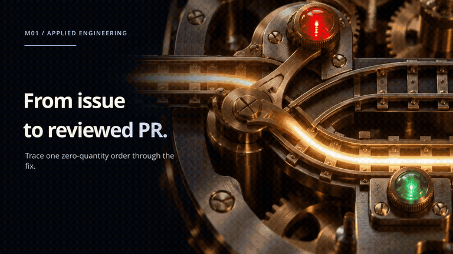

# Path de IA · Medio

Lleva un issue desde el plan hasta la revisión humana con GitHub CLI. Convierte los pasos repetidos en instrucciones, skills y workflows que puedas revisar.

Cada episodio tiene narración y subtítulos en inglés. El MP4 incluye capítulos para volver a un paso. [Descargar el episodio de muestra M01](https://github.com/Finithe-Phoenix/Path-Level-2-IA/raw/refs/heads/main/videos/M01.mp4).

[](https://github.com/Finithe-Phoenix/Path-Level-2-IA/raw/refs/heads/main/videos/M01.mp4)

| Episodio | Demostración | Duración | Archivos |
|---|---|---:|---|
| M01 | From Issue to Reviewed PR | 3:36 | [MP4](https://github.com/Finithe-Phoenix/Path-Level-2-IA/raw/refs/heads/main/videos/M01.mp4) · [SRT](subtitles/M01.en.srt) |
| M02 | Debug with a Failing Test | 2:51 | [MP4](https://github.com/Finithe-Phoenix/Path-Level-2-IA/raw/refs/heads/main/videos/M02.mp4) · [SRT](subtitles/M02.en.srt) |
| M03 | Review a Pull Request with GitHub CLI | 2:45 | [MP4](https://github.com/Finithe-Phoenix/Path-Level-2-IA/raw/refs/heads/main/videos/M03.mp4) · [SRT](subtitles/M03.en.srt) |
| M04 | Reusable Prompts and Repository Instructions | 2:56 | [MP4](https://github.com/Finithe-Phoenix/Path-Level-2-IA/raw/refs/heads/main/videos/M04.mp4) · [SRT](subtitles/M04.en.srt) |
| M05 | What Is a Skill? Build Your First One | 2:56 | [MP4](https://github.com/Finithe-Phoenix/Path-Level-2-IA/raw/refs/heads/main/videos/M05.mp4) · [SRT](subtitles/M05.en.srt) |
| M06 | Build a Workflow with Review Checkpoints | 2:53 | [MP4](https://github.com/Finithe-Phoenix/Path-Level-2-IA/raw/refs/heads/main/videos/M06.mp4) · [SRT](subtitles/M06.en.srt) |

## Reconstruir un episodio en GCP

En el workspace remoto, abre la raíz del repositorio. La producción utiliza Linux, Node.js 24, Python 3.12, FFmpeg y DejaVu Sans. La pista de voz, los subtítulos y los tiempos ya están en Git.

```bash
npm ci --prefix engine
python3 studio.py list
python3 studio.py render M01
python3 studio.py verify M01 --decode
```

El MP4 se escribe en `videos/M01.mp4`. Para renderizar el path completo, usa `python3 studio.py render all`. Para generar el proyecto HTML editable y su vista previa, ejecuta `python3 studio.py project M01` y abre `build/M01/preview.html`. Las instrucciones de HyperFrames y Remotion están en [engine/README.md](engine/README.md).

## Cambiar lo que se explica o cómo suena

Edita el guion, las acciones y los resultados de pantalla en [lessons/episodes.json](lessons/episodes.json). Cada episodio enlaza sus fuentes técnicas. El estilo, el ritmo y la mezcla de voces están en [voice/profile.json](voice/profile.json). Si cambias el texto hablado o el orden de las escenas, regenera la voz antes del render.

```bash
python3.12 -m venv .venv
source .venv/bin/activate
python -m pip install -r voice/requirements.txt
python voice/assets.py
python studio.py voice M01
python studio.py render M01
python studio.py verify M01 --decode
```

Para cambiar solo el ritmo, usa la toma original guardada en `takes/`. Por ejemplo, ejecuta `python3 studio.py pace M01 --target-wpm 142` y vuelve a renderizar. Este ajuste conserva el tono y recalcula escenas y subtítulos. La síntesis de voz descarga dos archivos de modelo con hashes fijados y los reutiliza. Las pistas AAC ya publicadas permiten editar la animación y volver a exportar sin sintetizar voz. [Detalles de narración](voice/README.md).

## Versionar la siguiente edición

Crea una rama para el cambio y conserva el ID de cada episodio. Tras revisar el video, ejecuta `python3 studio.py manifest` para renovar el inventario y `python3 studio.py verify all --release` para cotejar los archivos. Si el episodio editado aparece en la vista previa del README, regenera ese fragmento con `python3 preview.py`. Incluye las fuentes y los archivos generados en el mismo PR. La guía de trabajo está en [AGENTS.md](AGENTS.md).

Las pantallas y los datos del curso son simulaciones didácticas. Los PR del ejemplo los revisa una persona mediante `gh` en el terminal autorizado. Claude Code y OpenCode se ejecutan dentro del workspace de GCP.

Puedes consultar los [materiales de producción de la edición 1](archive/v1/) y los [videos originales](https://github.com/Finithe-Phoenix/Path-Level-2-IA/releases/tag/v1.0.0).

El validador y sus tres pruebas iniciales están en el [laboratorio de práctica](lab/).
