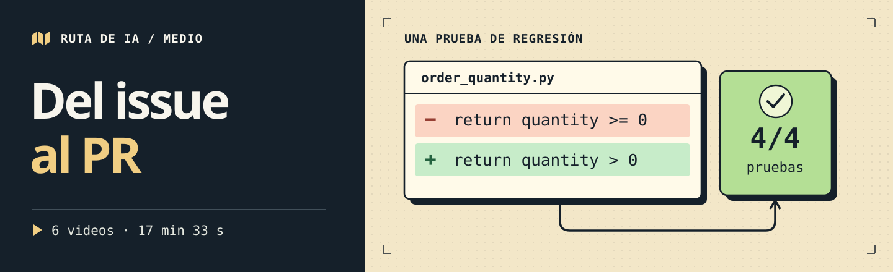

# Medio · Del issue al pull request

Sigue un defecto desde su reporte hasta la revisión de un compañero. Usarás Plan y Agent de Copilot en VS Code, reunirás pruebas de la corrección y verás cómo una persona revisa el PR con GitHub CLI desde el terminal autorizado.

**6 episodios · 17:33 en total.** Narración en inglés, subtítulos seleccionables y un capítulo por escena. En el selector de audio puedes elegir la mezcla con diseño sonoro o la voz sola.

[Descargar el primer episodio (M01)](https://github.com/Finithe-Phoenix/Path-Level-2-IA/raw/v3.0.0/videos/M01.mp4) · [Editar o reconstruir los videos](PRODUCCION.md)

Un desvío de latón abre la ruta. En el editor puedes seguir el cambio de operador y observar cómo responde la prueba de regresión.

## Temario

Selecciona el título para descargar el video. Puedes activar los subtítulos en tu reproductor o descargar el archivo SRT de cada episodio.

| Episodio | Qué harás en pantalla |
| --- | --- |
| **M01** · [From Issue to Reviewed PR](https://github.com/Finithe-Phoenix/Path-Level-2-IA/raw/v3.0.0/videos/M01.mp4) 3:31 · [SRT](https://github.com/Finithe-Phoenix/Path-Level-2-IA/raw/v3.0.0/subtitles/M01.en.srt) | Planifica una corrección, observa la prueba fallar y presenta el diff y los resultados en un PR. |
| **M02** · [Debug with a Failing Test](https://github.com/Finithe-Phoenix/Path-Level-2-IA/raw/v3.0.0/videos/M02.mp4) 2:48 · [SRT](https://github.com/Finithe-Phoenix/Path-Level-2-IA/raw/v3.0.0/subtitles/M02.en.srt) | Convierte el síntoma en una prueba que falla para cero y verifica que pasa tras cambiar la condición. |
| **M03** · [Review a Pull Request with GitHub CLI](https://github.com/Finithe-Phoenix/Path-Level-2-IA/raw/v3.0.0/videos/M03.mp4) 2:41 · [SRT](https://github.com/Finithe-Phoenix/Path-Level-2-IA/raw/v3.0.0/subtitles/M03.en.srt) | Inspecciona el diff y los checks con `gh`. Justifica por qué pedirías un cambio o aprobarías el PR. |
| **M04** · [Reusable Prompts and Repository Instructions](https://github.com/Finithe-Phoenix/Path-Level-2-IA/raw/v3.0.0/videos/M04.mp4) 2:52 · [SRT](https://github.com/Finithe-Phoenix/Path-Level-2-IA/raw/v3.0.0/subtitles/M04.en.srt) | Guarda una plantilla para tareas repetidas y registra en las instrucciones del repositorio la convención de pruebas. |
| **M05** · [What Is a Skill? Build Your First One](https://github.com/Finithe-Phoenix/Path-Level-2-IA/raw/v3.0.0/videos/M05.mp4) 2:52 · [SRT](https://github.com/Finithe-Phoenix/Path-Level-2-IA/raw/v3.0.0/subtitles/M05.en.srt) | Escribe un `SKILL.md` para preparar la evidencia de un PR. Pruébalo también cuando falten resultados. |
| **M06** · [Build a Workflow with Review Checkpoints](https://github.com/Finithe-Phoenix/Path-Level-2-IA/raw/v3.0.0/videos/M06.mp4) 2:49 · [SRT](https://github.com/Finithe-Phoenix/Path-Level-2-IA/raw/v3.0.0/subtitles/M06.en.srt) | Diseña un workflow que detiene la entrega si las pruebas fallan y reserva la decisión del PR al revisor. |

Ver un fragmento animado de M01

## Laboratorio de práctica

El proyecto incluye el validador de cantidades y tres pruebas iniciales. Puedes reproducir el fallo con un pedido de cero unidades y comprobar el resultado de tu arreglo en el workspace autorizado. [Abrir el laboratorio](lab/README.md).

## Fuentes editables

Para preparar una nueva edición, empieza por el guion y las referencias técnicas de cada escena. El repositorio también guarda los dibujos, la toma original de voz, el audio final y sus marcas de tiempo. [Guiones y referencias](lessons/episodes.json) · [Guía de producción](PRODUCCION.md) · [Guía para agentes](AGENTS.md) · [Descargar las fuentes de v3.0.0 en ZIP](https://github.com/Finithe-Phoenix/Path-Level-2-IA/archive/refs/tags/v3.0.0.zip).

[Consultar la edición anterior](https://github.com/Finithe-Phoenix/Path-Level-2-IA/releases/tag/v2.0.0).

## Otras rutas

[Básico](https://github.com/Finithe-Phoenix/Path-Level-1-IA) · [Avanzado](https://github.com/Finithe-Phoenix/Path-Level-3-IA) · [Managers](https://github.com/Finithe-Phoenix/Path-Level-Managers-IA)
